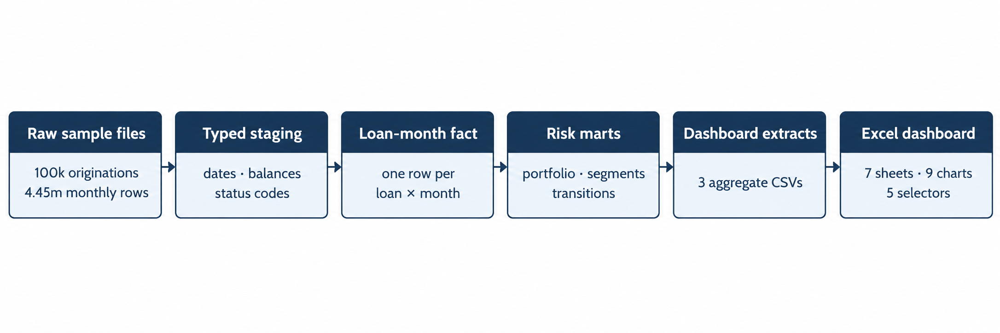
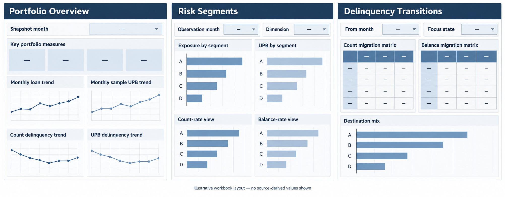

# Mortgage Portfolio Risk Monitoring with SQL and Excel

This project uses Freddie Mac 2019 and 2020 sample vintages to build a monthly mortgage portfolio-monitoring workflow with DuckDB, SQL, Python and Excel.

I separate on-book exposure from delinquency-eligible balances, track 30+/60+/90+ delinquency by both loan count and unpaid principal balance (UPB), compare risk across FICO, CLTV, DTI and origination-vintage groups, and measure exact month-to-month delinquency transitions.

## Project highlights

| Item | Scope |
|---|---:|
| Sampled originations | 100,000 |
| Monthly performance rows | 4,452,471 |
| Observation window | 87 months · 2019-01 to 2026-03 |
| Risk segmentation | FICO · CLTV · DTI · origination vintage |
| Core SQL validation | 19 / 19 checks passed in the verified local build |
| Excel reporting layer | 7 worksheets · 9 charts · 5 dropdown controls |
| Main tools | DuckDB · SQL · Python · Excel |

## Workflow



The four sample files are parsed into typed staging tables and a loan-month fact table. SQL builds portfolio, segment and transition marts; Python exports three aggregate CSVs and creates the workbook.

## Excel dashboard and public preview

The workbook has three dashboard pages:

- **Portfolio Overview:** exposure, eligibility coverage and count- and UPB-based delinquency trends.
- **Risk Segments:** exposure and delinquency by selected month and dimension.
- **Delinquency Transitions:** count and beginning-UPB migration matrices plus an origin-state chart.

Three aggregate data sheets and a ReadMe sheet support the dashboards. Native Excel formulas, nine charts and five dropdown controls are used; no loan identifiers or loan-level rows are written.

The preview illustrates the workbook layout without publishing source-derived values or a data-bearing screenshot.



## Analysis scope

- Monthly on-book loan count and sample UPB exposure.
- 30+/60+/90+ delinquency by both loan count and eligible UPB.
- Independent views by Classic FICO, Original CLTV, Original DTI and origination vintage.
- Exact next-calendar-month transitions between current, delinquent, terminal and other states.

Segment views are produced independently for origination vintage, Classic FICO, Original CLTV and Original DTI. Missing and sentinel values remain `Unknown` rather than entering the highest-risk band. Details are in [docs/project_notes.md](docs/project_notes.md).

## Portfolio and delinquency definitions

A record is **on book** when Current Actual UPB is positive and Zero Balance Code is blank. Zero-balance terminal records remain available for transitions but are excluded from month-end exposure.

The **delinquency-eligible** population is narrower: on book, Loan Age at least 1, and a numeric Current Loan Delinquency Status from `00` through `99`. Loan Age 0, `RA`, `XX`, missing or invalid statuses, and terminal rows do not enter this denominator. The dashboard shows eligible coverage against the broader on-book population.

| Threshold | Definition |
|---|---|
| 30+ | numeric status `>= 01` |
| 60+ | numeric status `>= 02` |
| 90+ | numeric status `>= 03` |

Count rates divide delinquent loans by eligible loans; UPB-weighted rates divide delinquent UPB by eligible UPB. They can differ when loan size and performance are related. **90+ is treated as severe delinquency, not automatically as default.** Default would require a separate event rule, such as selected zero-balance, disposition or REO outcomes.

## Monthly transitions

A transition pairs the same loan only across exact consecutive calendar months. The next available record after a gap is not a monthly transition. The origin must be on book; the destination may be current, 30, 60, 90+, REO, unknown or terminal.

The count-rate denominator is observable loans in the origin-month and origin-state cohort; the balance-rate denominator is their origin-month UPB. A final observation without the next calendar month is right-censored and excluded. Exact pairing and low-volume rules are in [docs/project_notes.md](docs/project_notes.md).

## Validation

The final SQL build contains 19 core analytical checks covering source counts, key uniqueness and coverage, date/status validity, population logic, delinquency hierarchy, segment reconciliation, independent monthly recalculation, and transition timing/cohort reconciliation. All 19 passed in the verified local build.

Raw-file validation and dashboard-export checks run separately so the SQL layer remains focused on the analytical results. The SQL checks are defined in [sql/90_validation_checks.sql](sql/90_validation_checks.sql).

## Dataset and publication boundary

The input is the Freddie Mac Single-Family Loan-Level Dataset sample for the 2019 and 2020 origination vintages: two origination and two monthly performance files. The year labels are origination vintages; performance continues into later years. The analytical grain is `(loan_id, as_of_month)`.

The repository does not publish raw Freddie Mac files, generated loan-level artifacts, aggregate exports, the workbook, or data-bearing screenshots. The public images are non-data-bearing diagrams and layouts. Users must obtain the samples from Freddie Mac and follow applicable terms. See [NOTICE.md](NOTICE.md).

## Repository structure

```text
.
├── README.md
├── NOTICE.md
├── requirements.txt
├── docs/
│   ├── project_notes.md
│   └── assets/
│       ├── project_workflow.png
│       └── dashboard_views.png
├── scripts/
│   ├── validate_raw_data.py
│   ├── build_data_layer.py
│   ├── export_dashboard_data.py
│   └── build_excel_dashboard.py
└── sql/
    ├── 00_init.sql
    ├── 10_staging.sql
    ├── 20_curated.sql
    ├── 30_marts.sql
    ├── 40_dashboard_exports.sql
    └── 90_validation_checks.sql
```

Metric definitions and transition pairing are in `sql/20_curated.sql` and `sql/30_marts.sql`; supporting details are in [docs/project_notes.md](docs/project_notes.md).

## How to run

Place the downloaded sample files at:

```text
data/raw/sample_2019/sample_orig_2019.txt
data/raw/sample_2019/sample_perf_2019.txt
data/raw/sample_2020/sample_orig_2020.txt
data/raw/sample_2020/sample_perf_2020.txt
```

Then run:

```bash
python3 -m venv .venv
.venv/bin/python -m pip install -r requirements.txt
.venv/bin/python scripts/validate_raw_data.py
.venv/bin/python scripts/build_data_layer.py
.venv/bin/python scripts/build_excel_dashboard.py
```

The final command refreshes the three aggregate dashboard CSVs before creating `outputs/mortgage_portfolio_risk_monitoring_sql_excel_dashboard.xlsx`.

## Limitations

This is descriptive portfolio monitoring, not predictive credit modeling or expected-loss estimation. It uses two annual samples, not the full Freddie Mac population or live lender data. Trends reflect entry timing, seasoning, payoff and other exits, right-censoring, and changing remaining sample composition. The workbook requires a local rebuild to refresh.

## Official references

- [Freddie Mac Single-Family Loan-Level Dataset](https://www.freddiemac.com/research/datasets/sf-loanlevel-dataset)
- [Release 47 General User Guide](https://www.freddiemac.com/fmac-resources/research/pdf/general_user_guide_july_2026.pdf)
- [Release 47 File Layout](https://www.freddiemac.com/fmac-resources/research/pdf/file_layout_july_2026.xlsx)
